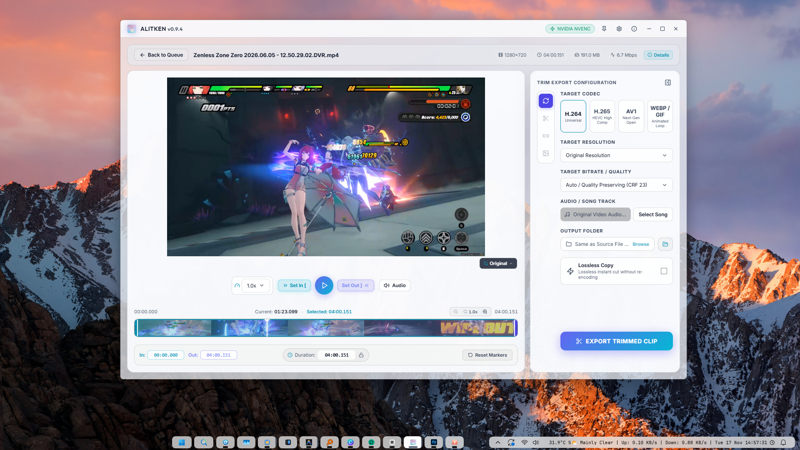
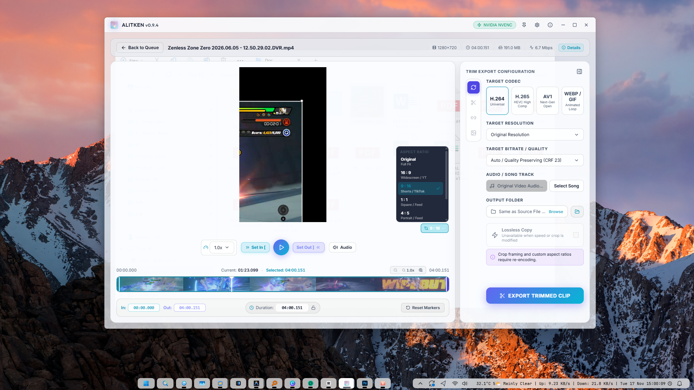
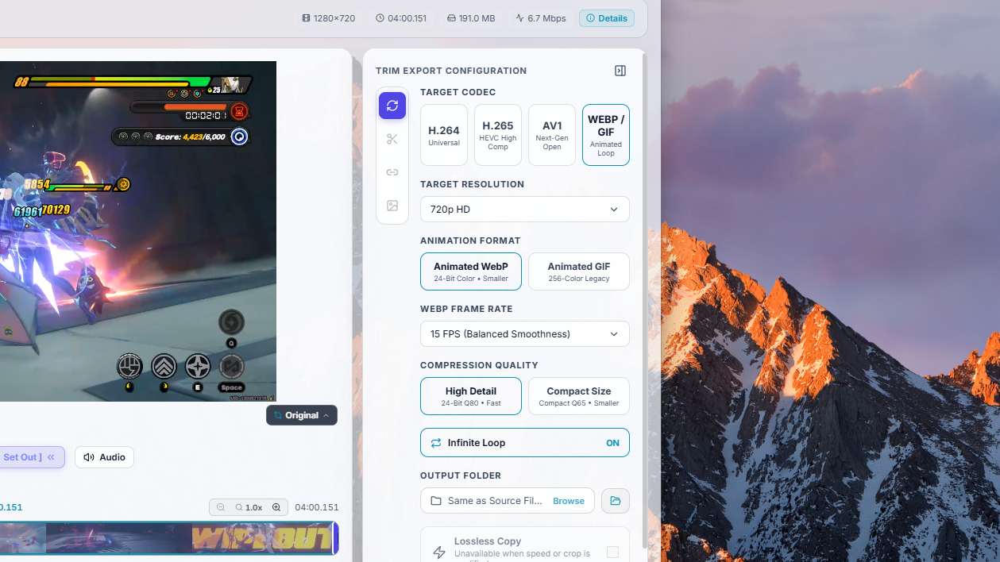
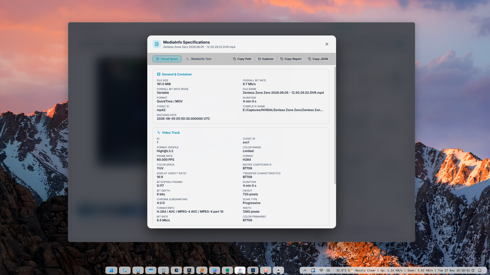
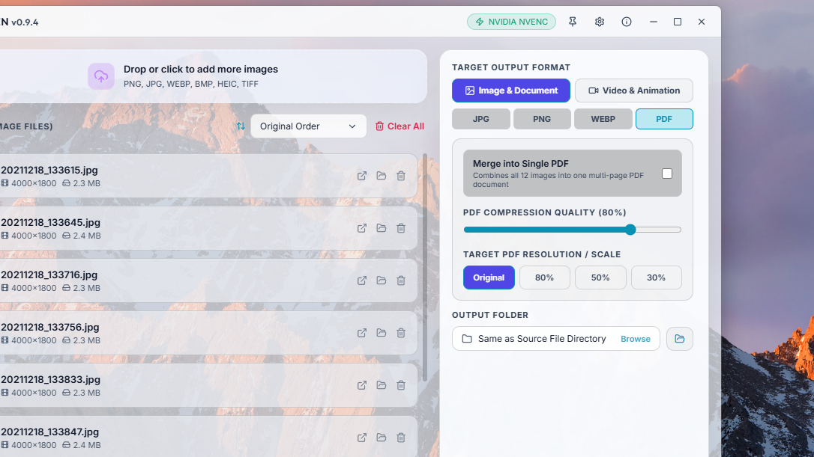
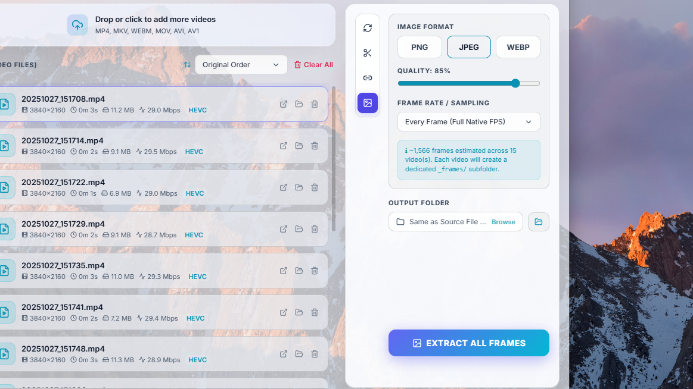

<div align="center">

  # ⚡ ALITKEN

  ### Pro-grade video conversion, trimming, and animation. Effortlessly simple.
  
  *Designed from the ground up for Windows 11. Feather-light, blazingly fast, and wrapped in translucent frosted glass.*  
  *Instant lossless cuts • One-click social framing • Studio-quality 1080p WebP & GIF • 52+ image formats.*

  <br />

  <p align="center">
    <a href="https://github.com/Crlyzd/Alitken-GUI/releases/latest"></a>
    <a href="https://github.com/Crlyzd/Alitken-GUI/releases/latest"></a>
    <a href="LICENSE"></a>
    <a href="#-the-manifesto-why-i-built-this-a-rant"></a>
  </p>

  <p align="center">
    <a href="https://github.com/Crlyzd/Alitken-GUI/releases/latest"><b>Download Portable App</b></a> •
    <a href="#-how-alitken-compares"><b>Why Alitken</b></a> •
    <a href="#-designed-for-everything-you-create"><b>Features</b></a> •
    <a href="#-quick-start"><b>Quick Start</b></a> •
    <a href="#-supported-formats--requirements"><b>Formats</b></a> •
    <a href="#-open-source-credits"><b>Credits</b></a> •
    <a href="#-support--donations"><b>Support</b></a>
  </p>

  <br />

  

  <br />
  <sub><b>#1 — Main Workspace & Batch Media Queue</b> (<code>assets/1.png</code>)</sub>

</div>

---

### 💬 The Manifesto: Why I Built This (A Rant)

> **TL;DR:** I am so sick and tired of media converters on Windows. Seriously, why is this entire category of software such an absolute disaster zone?
>
> * **The Ancient Relic Tools:** Great power underneath, sure, but the interfaces look like they were built in 1995 by someone who fundamentally hates human eyes. You are greeted with 4,000 cryptic dropdowns, nested tabs from hell, and a screen that requires an engineering degree just to turn a 5-second `.mov` file into an `.mp4`. Why do I need to navigate a 50-page audio menu just to trim a clip for Discord?
> * **The Corporate Paywall Traps:** The shiny-looking converters that rank #1 on search engines spend all their budget on ads and zero on respecting your time. You install it, wait 15 minutes for your file to process, and right when it finishes, it slaps a massive ugly watermark over the center of your video and demands a $49/year subscription just to unlock 1080p export.
> * **The "Free" Bloatware Nightmares:** The rest of the "free" utilities out there are horrific. They install 40 background services you can't disable, clutter your system, bundle 500MB of junk for a simple task, and demand an endless setup wizard just to open. And when you finally use them? They take 45 minutes to export a 30-second clip, maxing out your processor until your fans sound like a jet engine.
> * **The Online Web Converters:** Don't even get me started on web converters. Uploading a 2GB gameplay clip over your home internet, waiting in a queue for 20 minutes, having your quality capped at 720p, and dodging 15 fake "DOWNLOAD HERE" popups just to get your file back.
>
> I just wanted **one** normal tool:
> 1. Completely **free** with no paywalls or trial watermarks.
> 2. **Portable** with zero installation clutter.
> 3. **Blazingly fast** using the full power of your graphics card.
> 4. Able to **snip clips in seconds** with zero quality loss.
> 5. A **modern, sleek Windows 11 design** that actually feels good to use.
>
> Nobody else seemed capable of making an app that wasn't either a relic from 2005 or a greedy subscription trap, so I built **Alitken**. No nonsense, no paywalls, no bloatware, no hassle.

---

## 📊 How Alitken Compares

| Feature | 👴 Traditional Tools | 💸 Paywall Converters | 🌐 Web Converters | ⚡ **Alitken** |
| :--- | :---: | :---: | :---: | :---: |
| **Pricing & Watermarks** | Free | $49/yr + Watermarks | Free with size/quality caps | **100% Free & Clean** |
| **App Footprint** | Clunky installer | 500 MB+ Background Services | Popups & tracking | **~5 MB Portable Single File** |
| **Video Cutting Speed** | Re-encodes slowly | Re-encodes slowly | Slow upload & queue | **Instant Lossless (`< 1 sec`)** |
| **Animated WebP & GIF** | Complex manual setup | Watermarked or low FPS | Heavy compression | **Studio 1080p WebP & 720p GIF** |
| **Interface & Feel** | Dated 90s menus | Aggressive upgrade ads | Banner ads everywhere | **Translucent Frosted Glass UI** |
| **Social Framing (Shorts/TikTok)** | Manual pixel math | Locked behind paywall | Unsupported | **One-Click 9:16 / 1:1 Presets** |
| **Custom Audio & Fades** | Confusing multi-step setup | Paid feature | Unsupported | **Built-in Soundtrack + Fades** |
| **Graphics Acceleration** | Manual configuration | Watermarked on free tier | Throttled servers | **Automatic NVIDIA / AMD / Intel** |
| **Broken-File Protection** | Crashes on bad files | Fails silently | Upload timeout | **Smart Pre-Flight Guard** |
| **Media Details** | Needs separate apps | Basic info or paywalled | Unsupported | **Built-in Media Inspector** |

---

## 🌟 Designed for Everything You Create

### #2 — Instant Trimmer, Precision Zoom & Speed Studio (`assets/2.png`)
* **Cut in a Blink. Zero Quality Loss.** Snip highlights from multi-hour recordings in under a second—preserving every single pixel of the original video.
* **Precision Timeline.** Zoom smoothly into your timeline (`1.0x–10.0x`), pan effortlessly, slide your entire selection range at once, and scrub with instant hover previews.
* **Time, Your Way (`0.10x–50.00x`).** Slow down epic moments with *Fast* or *Optical Smooth* motion, or speed through timelapses with natural, pitch-preserved audio.

<p align="center">
  
</p>

---

### #3 — One-Click Social Media Framing (`assets/3.png`)
* **Ready for Every Feed.** Switch instantly between **9:16 (Shorts / TikTok)**, **1:1 (Square)**, **4:5 (Portrait)**, **16:9 (Widescreen)**, **4:3**, or **21:9**.
* **Razor-Sharp Crop Guides.** Precision framing lines stay crisp at every zoom level.
* **Effortless Control.** Drag any corner freely and snap cleanly to edges and centers.

<p align="center">
  
</p>

---

### #4 — Animated WebP & GIF Studio (`assets/4.png`)
* **True-Color Animated WebP.** Create ultra-crisp, lightweight animations up to **1080p Full HD**—rich detail, tiny file sizes, and none of the muddy banding.
* **Effortless Animated GIF.** Export smooth, vibrant GIFs up to **720p HD** with smart color optimization, custom frame rates (`10` / `15` / `24` / `30` / `Original`), and simple loop controls.
* **Everywhere You Need It.** Built right into batch **Video Convert**, **Video Trimmer**, and **Image-to-Animation**—complete with smooth transparent backgrounds for images.

<p align="center">
  
</p>

---

### #5 — Deep Media Inspector (`assets/5.png`)
* **Every Detail, Beautifully Organized.** Inspect resolution, frame rate, color depth, audio channels, bitrate, and format details right from your queue or trimmer.
* **Two Ways to View.** Toggle effortlessly between clean visual spec cards and classic full-text reports.
* **One-Click Share & Reveal.** Copy file paths, jump straight to the file in Explorer, or export full media details in a click.

<p align="center">
  
</p>

---

### #6 — Clip Combiner, Splitter & Soundtrack Studio (`assets/6.png`)
* **Seamless Clip Merging.** Automatically checks if your clips can be joined in under a second with zero quality loss—or blends mixed formats together seamlessly.
* **Precision Splitting.** Break long videos into equal parts or exact durations with instant lossless cuts or custom-cropped exports.
* **Custom Soundtracks.** Drop in your own `.mp3`, `.aac`, `.wav`, or `.flac` audio track with smooth **Fade In** and **Fade Out** transitions.

<p align="center">
  
</p>

---

### #7 — 52-Format Image Studio, PDF Merger & Slideshows (`assets/7.png`)
* **Speak Every Image Format.** Batch convert Camera RAW (`.cr2`, `.cr3`, `.nef`, `.arw`, `.dng`, `.raf`), `.heic`, `.avif`, `.jxl`, Photoshop (`.psd`, `.psb`), `.svg`, `.ico`, `.webp`, and `.gif` into `.jpg`, `.png`, `.webp`, or single/merged `.pdf` documents.
* **Photos in Motion.** Turn mixed photo sets into **4K MP4 videos**, **1080p Animated WebP**, or **720p Animated GIF** with smart portrait/landscape framing and optional transparent backgrounds.

<p align="center">
  
</p>

---

### #8 — High-Speed Frame Extractor & Storage Guard (`assets/8.png`)
* **Every Frame, Captured.** Extract crisp `.png`, `.jpg`, or `.webp` image sequences into organized `_frames/` folders at `Every Frame`, `30`, `10`, `5`, or `1` FPS—powered by next-gen high-speed decoding.
* **Smart Space Check.** Estimates output size before you start, protecting your drive from unexpectedly filling up.

<p align="center">
  
</p>

---

### #9 — Automatic Graphics Power & Frosted Glass Design (`assets/9.png`)
* **Performance on Autopilot.** Automatically taps into your **NVIDIA**, **AMD**, or **Intel** graphics card for blazingly fast exports—while keeping original audio untouched.
* **Crashproof Queue.** Spots missing or broken 0-byte files before processing starts, with one-click cleanup.
* **Thoughtfully Crafted.** Adaptive Dark and Light frosted glass themes, a compact drop window that expands into a full studio workspace the moment you add files, and feather-light memory usage.

<p align="center">
  
</p>

---

<details>
<summary>📸 <b>Screenshot Guide (<code>assets/1.png</code> – <code>assets/9.png</code>)</b></summary>

Replace the placeholder PNGs in [`assets/`](assets/) with real captures:

| File | Section | Subject to Capture |
| :--- | :--- | :--- |
| `assets/1.png` | Hero Banner | Main workspace with queued videos/images & config sidebar |
| `assets/2.png` | Instant Trimmer | Trimmer timeline zoomed in with In/Out handles & speed controls |
| `assets/3.png` | Social Framing | Trimmer 9:16 or 1:1 crop wireframe overlay |
| `assets/4.png` | WebP & GIF Studio | `WEBP / GIF` card selected showing animation options |
| `assets/5.png` | Media Inspector | Deep Media Inspector open showing Visual Specs / Text view |
| `assets/6.png` | Combiner & Splitter | Combine or Split mode controls with compatibility badge & audio fades |
| `assets/7.png` | Image & Slideshow | Image config panel showing `Video & Animation` options |
| `assets/8.png` | Frame Extractor | `Extract Frames` panel & storage space check |
| `assets/9.png` | Power & Design | Progress / Settings modal or Light/Dark mode titlebar GPU badge |

</details>

---

## 🚀 Quick Start

1. **Download**: Grab `Alitken_64-Portable.exe` from the [Latest Releases](https://github.com/Crlyzd/Alitken-GUI/releases/latest).
2. **Drop Your Media**: Drag videos or images straight into the compact drop window—or right-click any file in Windows Explorer and choose **Send to → Alitken**.
3. **Pick Your Workflow**:
   * **Video Convert / Animation**: Export to `.mp4` / `.mkv`, or create crisp `.webp` (up to 1080p) and `.gif` (up to 720p) animations.
   * **Split / Trim**: Mark start and end points, adjust speed (`0.10x–50.00x`), or frame for `9:16` / `1:1`.
   * **Combine**: Merge clips in order and add a custom soundtrack with smooth Fade In/Out.
   * **Extract Frames**: Save frame sequences as `.png`, `.jpg`, or `.webp`.
   * **Image & Slideshow**: Batch convert 52+ image formats, merge PDFs, or animate photo sets into `.mp4`, `.webp`, or `.gif`.
4. **Go**: Hit start and watch live progress and time remaining.

---

## 💻 Supported Formats & Requirements

* **Operating System**: Windows 10 or Windows 11 (64-bit & ARM64)
* **Video Inputs**: `.mp4`, `.mkv`, `.webm`, `.mov`, `.avi`, `.wmv`, `.m4v`, `.flv`, `.ts`, `.mts`, `.m2ts`, `.3gp`, `.mxf`
* **Video & Animation Outputs**: `.mp4` (H.264 / HEVC), `.mkv` (AV1), `.webp` (Animated WebP up to 1080p), `.gif` (Animated GIF up to 720p), or original format (Lossless Cut)
* **Soundtrack Audio**: `.mp3`, `.aac`, `.wav`, `.m4a`, `.flac` *(for background music replacement & audio mixing)*
* **Image Inputs (52+ Formats)**:
  * **Standard & Modern**: `.png`, `.jpg`, `.jpeg`, `.webp`, `.bmp`, `.gif`, `.tiff`, `.heic`, `.heif`, `.avif`, `.jxl`, `.qoi`
  * **Creative & Vector**: Photoshop (`.psd`, `.psb`), Vector (`.svg`, `.svgz`), GIMP (`.xcf`), Icons (`.ico`, `.cur`)
  * **Gaming & HDR**: `.dds`, `.tga`, Pixel art (`.ase`, `.aseprite`), OpenEXR (`.exr`), Radiance HDR (`.hdr`)
  * **Camera RAW**: `.dng`, `.cr2`, `.cr3`, `.nef`, `.arw`, `.orf`, `.rw2`, `.pef`, `.raf`, `.fff`, `.dcr`, `.kdc`, `.k25`, `.erf`, `.srw`, `.mrw`, `.mef`, `.mos`, `.3fr`, `.raw`, `.x3f`
* **Image Outputs**: `.png`, `.jpg`, `.webp`, `.pdf` (single or merged), `.mp4` (Slideshow up to 4K), `.webp` (Animated WebP up to 1080p), or `.gif` (Animated GIF up to 720p)

---

<details>
<summary>🛠️ <b>For Developers: Architecture & Build Toolchain</b></summary>

### Architecture Overview
* **Frontend**: React 18, TypeScript 5.7, Vite 6, Vanilla CSS frosted glass system.
* **Desktop Core**: Tauri v2, Rust (2021 Edition), Tokio async runtime, Win32 borderless window subclassing, Windows Media Foundation / D3D11 previews.
* **Media Engines**: FFmpeg (GPLv3), FFprobe, ImageMagick 7, VideoLAN `libdav1d` AV1 decoder, `libwebp`, and hardware encoders (NVENC / AMF / QSV).

### Build Script (`build.ps1`)
```powershell
.\build.ps1                              # Launch interactive developer dashboard
.\build.ps1 -Dev                         # Start Vite + Tauri development server
.\build.ps1 -ReleaseScope all            # Build multi-target x64/ARM64 release packages
.\build.ps1 -Bump -BumpType patch        # Bump & sync version across all manifests
```

</details>

---

## 🙏 Open-Source Credits

Alitken is built on the shoulders of extraordinary open-source projects. Huge thanks to the maintainers and contributors of every project below:

### Media & Image Engines

| Project | License | Role in Alitken |
| :--- | :--- | :--- |
| **[FFmpeg](https://ffmpeg.org/) & `ffprobe`** | GPLv3 | Video conversion, lossless cutting, audio mixing, and animation encoding |
| **[BtbN/FFmpeg-Builds](https://github.com/BtbN/FFmpeg-Builds)** | GPLv3 | Automated Windows x64 & ARM64 FFmpeg builds |
| **[ImageMagick 7](https://github.com/ImageMagick/ImageMagick)** | ImageMagick License | 52+ format image conversion, Camera RAW / PSD / HEIC support, and PDF creation |
| **[VideoLAN `libdav1d`](https://code.videolan.org/videolan/dav1d)** | BSD-2-Clause | High-speed AV1 video decoding |
| **[`libwebp`](https://chromium.googlesource.com/webm/libwebp)** *(Google WebP Project)* | BSD-3-Clause | High-detail Animated WebP encoding with transparency support |
| **[`x264`](https://www.videolan.org/developers/x264.html), [`x265`](https://www.videolan.org/developers/x265.html) & [`libaom-av1`](https://aomedia.googlesource.com/aom/)** | GPLv2 / Apache-2.0 | Software video encoders alongside NVIDIA, AMD, and Intel hardware acceleration |

### Desktop App & Interface

| Project | License | Role in Alitken |
| :--- | :--- | :--- |
| **[Tauri v2](https://v2.tauri.app/)** | Apache-2.0 / MIT | Lightweight native Windows desktop shell and system dialogs |
| **[Rust](https://www.rust-lang.org/) & [Tokio](https://tokio.rs/)** | MIT / Apache-2.0 | Fast, memory-safe native core and background task engine |
| **[`windows-rs`](https://github.com/microsoft/windows-rs) & `windows-sys`** | MIT / Apache-2.0 | Native Windows borderless glass windowing and hardware video previews |
| **[`serde`](https://serde.rs/) & `serde_json`** | MIT / Apache-2.0 | Structured data and media inspection parsing |
| **[`reqwest`](https://github.com/seanmonstar/reqwest), [`zip`](https://github.com/zip-rs/zip2) & [`sevenz-rust`](https://github.com/dyz1990/sevenz-rust)** | MIT / Apache-2.0 | Dependency downloads and archive extraction |
| **[`regex`](https://github.com/rust-lang/regex), [`walkdir`](https://github.com/BurntSushi/walkdir), [`dirs`](https://github.com/dirs-dev/dirs-rs), [`log`](https://github.com/rust-lang/log) & [`env_logger`](https://github.com/rust-cli/env_logger)** | MIT / Apache-2.0 | Progress tracking, folder scanning, and logging |
| **[React 18](https://react.dev/), [TypeScript 5.7](https://www.typescriptlang.org/) & [Vite 6](https://vite.dev/)** | MIT / Apache-2.0 | User interface and frontend build tooling |
| **[Lucide (`lucide-react`)](https://lucide.dev/) & [`clsx`](https://github.com/lukeed/clsx)** | ISC / MIT | Crisp vector icons and UI styling utilities |

---

## ❤️ Support & Donations

Alitken is completely free, open source, and built with love by **Kaleksanan Bagus**. If this tool saved you from subscription traps, watermarked videos, or jet-engine fans, consider buying me a coffee:

<p align="center">
  <a href="https://saweria.co/curlyzed"></a>
  &nbsp;&nbsp;
  <a href="https://ko-fi.com/curlyzed"></a>
</p>

---

<div align="center">
  <sub>Licensed under <a href="LICENSE">GNU General Public License v3.0</a>. Built for creators, gamers, and humans.</sub>
</div>
