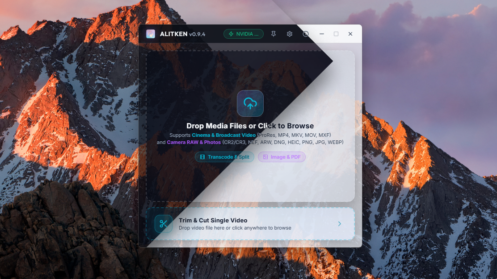
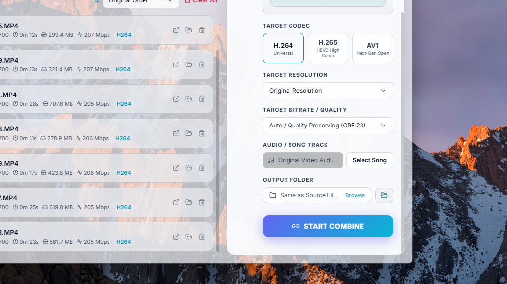
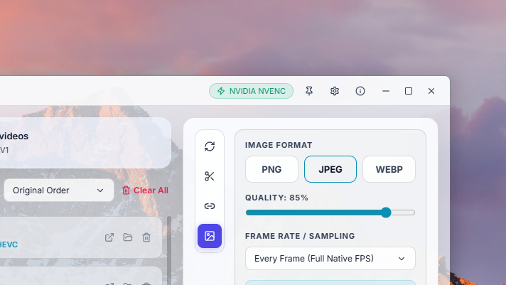

<div align="center">

  # ⚡ ALITKEN

  ### Big power. Zero clutter. Made for Windows.
  
  *Cut clips in a snap. Frame for any feed. Turn videos and photos into crisp animations—all in one feather-light, frosted-glass app.*  
  *Instant cuts • One-click social framing • Sharp WebP & GIF loops • 52+ image formats & PDFs.*

  <br />

  <p align="center">
    <a href="https://github.com/Crlyzd/Alitken-GUI/releases/latest"></a>
    <a href="https://github.com/Crlyzd/Alitken-GUI/releases/latest"></a>
    <a href="LICENSE"></a>
    <a href="#-the-manifesto-why-i-built-this-a-rant"></a>
  </p>

  <p align="center">
    <a href="https://github.com/Crlyzd/Alitken-GUI/releases/latest"><b>Download Portable App</b></a> •
    <a href="#-how-alitken-compares"><b>Why Alitken</b></a> •
    <a href="#-designed-for-everything-you-create"><b>Features</b></a> •
    <a href="#-quick-start"><b>Quick Start</b></a> •
    <a href="#-what-it-works-with"><b>Formats</b></a> •
    <a href="#-open-source-credits"><b>Credits</b></a> •
    <a href="#-support--donations"><b>Support</b></a>
  </p>

  <br />

  

  <br />
  <sub><b>Drop and go.</b> A compact frosted-glass window in Dark and Light mode that expands the moment you add files.</sub>

</div>

---

### 💬 The Manifesto: Why I Built This (A Rant)

**TL;DR:** I am so sick and tired of media converters on Windows. Seriously, why is this entire category of software such an absolute disaster zone?

* **The Ancient Relic Tools:** Great power underneath, sure, but the interfaces look like they were built in 1995 by someone who fundamentally hates human eyes. You are greeted with 4,000 cryptic dropdowns, nested tabs from hell, and a screen that requires an engineering degree just to turn a 5-second `.mov` file into an `.mp4`. Why do I need to navigate a 50-page audio menu just to trim a clip for Discord?
* **The Corporate Paywall Traps:** The shiny-looking converters that rank #1 on search engines spend all their budget on ads and zero on respecting your time. You install it, wait 15 minutes for your file to process, and right when it finishes, it slaps a massive ugly watermark over the center of your video and demands a $49/year subscription just to unlock 1080p export.
* **The "Free" Bloatware Nightmares:** The rest of the "free" utilities out there are horrific. They install 40 background services you can't disable, clutter your system, bundle 500MB of junk for a simple task, and demand an endless setup wizard just to open. And when you finally use them? They take 45 minutes to export a 30-second clip, maxing out your processor until your fans sound like a jet engine.
* **The Online Web Converters:** Don't even get me started on web converters. Uploading a 2GB gameplay clip over your home internet, waiting in a queue for 20 minutes, having your quality capped at 720p, and dodging 15 fake "DOWNLOAD HERE" popups just to get your file back.

I just wanted **one** normal tool:
1. Completely **free** with no paywalls or trial watermarks.
2. **Portable** with zero installation clutter.
3. **Blazingly fast** using the full power of your graphics card.
4. Able to **snip clips in seconds** with zero quality loss.
5. A **modern, sleek Windows 11 design** that actually feels good to use.

Nobody else seemed capable of making an app that wasn't either a relic from 2005 or a greedy subscription trap, so I built **Alitken**. No nonsense, no paywalls, no bloatware, no hassle.

---

### ✨ Why "Alitken"?

<div align="center">

**📖 THE LINGUISTIC ORIGINS**

## **ALITKEN** &nbsp; `[ ah • leet • ken ]` &nbsp;•&nbsp; `ꦲꦭꦶꦠ꧀ꦏꦼꦤ꧀`

| Root Word *(Javanese)* | | Causative Suffix | | Literal Translation |
| :---: | :---: | :---: | :---: | :---: |
| **Alit**<br /><sub>Small, compact, lightweight, or lean *(the opposite of *ageng* / big)*.</sub> | **+** | **`-ken`** `(-aken)`<br /><sub>Action suffix meaning *to make* or *cause something to become*.</sub> | **=** | **"Make It Smaller"**<br /><sub>Shrink, compress, and trim heavy files down to their leanest essence.</sub> |

<sub>A cultural tribute by Indonesian developer **Kaleksanan Bagus Massani**. Alitken was built around one simple idea: skip the gigabytes of bloated code, deliver a clean ~5 MB portable app, and turn heavy 4K media into lightweight, crisp clips with zero quality loss.</sub>

</div>

---

## 📊 How Alitken Compares

| Feature | 👴 Traditional Tools | 💸 Paywall Converters | 🌐 Web Converters | ⚡ **Alitken** |
| :--- | :---: | :---: | :---: | :---: |
| **Pricing & Watermarks** | Free | $49/yr + Watermarks | Free with size & quality limits | **100% Free & Clean** |
| **App Size** | Clunky installer | 500 MB+ background junk | Popups & tracking | **~5 MB Portable Single File** |
| **Video Cutting Speed** | Slow re-saving | Slow re-saving | Slow upload & queue | **Instant Cut (`< 1 sec`)** |
| **Animated WebP & GIF** | Confusing manual setup | Watermarked or choppy | Blurry compression | **Crisp Full HD WebP & HD GIF** |
| **Look & Feel** | Dated 90s menus | Aggressive upgrade ads | Banner ads everywhere | **Translucent Frosted Glass** |
| **Social Framing (Shorts/TikTok)** | Manual guesswork | Locked behind paywall | Not supported | **One-Click 9:16 & 1:1 Presets** |
| **Custom Music & Fades** | Multi-step headache | Paid feature | Not supported | **Built-in Song Picker + Fades** |
| **Graphics Card Speed** | Manual setup | Watermarked on free tier | Throttled servers | **Automatic NVIDIA / AMD / Intel** |
| **Broken-File Protection** | Crashes on bad files | Fails silently | Upload timeout | **Catches Bad Files Early** |
| **Video & Photo Details** | Needs separate apps | Basic info or paywalled | Not supported | **Built-in Media Inspector** |

---

## 🌟 Designed for Everything You Create

### Instant Trimmer & Speed Studio
* **Cut in a Blink. Zero Quality Loss.** Snip highlights from long recordings in under a second—every pixel stays just as sharp as the original.
* **Effortless Timeline.** Zoom in close, glide through your clip, slide your whole selection at once, and find the exact moment without fighting tiny controls.
* **Slow Motion & Timelapse.** Slow down epic plays smoothly or breeze through long videos—voices still sound natural, never like a chipmunk.

<p align="center">
  
</p>

---

### One-Click Social Media Framing
* **Ready for Every Feed.** Switch in one click between **9:16 (Shorts / TikTok)**, **1:1 (Square)**, **4:5 (Portrait)**, **16:9 (Widescreen)**, **4:3**, or **21:9**.
* **Crisp Framing Guides.** Clean border lines stay sharp while you zoom and position your shot.
* **Drag, Snap, Done.** Resize from any corner and snap neatly to edges and centers.

<p align="center">
  
</p>

---

### Animated WebP & GIF Studio
* **Sharper Than Ever.** Save rich, smooth **Animated WebP** loops up to **Full HD** with tiny file sizes and none of the washed-out, blotchy colors.
* **Classic GIFs Made Easy.** Export vibrant **Animated GIFs** up to **HD** with simple smoothness, size, and infinite-loop toggles.
* **Works Everywhere.** Available when converting videos, trimming clips, or turning a stack of photos into an animation—even with clean transparent backgrounds.

<p align="center">
  
</p>

---

### Deep Media Inspector
* **Everything at a Glance.** Check size, length, screen dimensions, smoothness, and sound quality right from your queue or trimmer.
* **Visual Cards or Plain Text.** Switch effortlessly between clean info cards and a classic full report.
* **Share in One Click.** Copy the file path, open its folder, or copy the full summary straight to your clipboard.

<p align="center">
  
</p>

---

### Clip Combiner, Splitter & Soundtracks
* **Join Clips Seamlessly.** Merge multiple videos together in order—instantly when they match, or smoothly blended when they don't.
* **Split Long Videos.** Break huge recordings into neat, equal parts or exact lengths in seconds.
* **Add Your Own Music.** Drop in your favorite song (`.mp3`, `.aac`, `.wav`, or `.flac`) with smooth **Fade In** and **Fade Out** transitions.

<p align="center">
  
</p>

---

### 52-Format Image Studio, PDF Merger & Slideshows
* **Opens Almost Anything.** Turn iPhone photos (`.heic`), Camera RAW shots, Photoshop files (`.psd`), icons, and everyday pictures into `.jpg`, `.png`, `.webp`, or clean `.pdf` documents.
* **Merge Into One PDF.** Combine a whole batch of photos into a single, easy-to-share PDF with adjustable size and quality.
* **Photos in Motion.** Turn any photo stack into a crisp **4K video**, **Animated WebP**, or **Animated GIF** in one click.

<p align="center">
  
</p>

---

### High-Speed Frame Extractor & Space Guard
* **Capture Every Moment.** Pull crisp `.png`, `.jpg`, or `.webp` pictures out of any video into neat `_frames/` folders—save every single frame or pick a lighter pace.
* **No Surprises.** Estimates how many frames will be created and checks your free drive space before starting, so your disk never fills up by accident.

<p align="center">
  
</p>

---

### Automatic Graphics Power & Frosted Glass Design
* **Fast on Autopilot.** Automatically puts your **NVIDIA**, **AMD**, or **Intel** graphics card to work for blazingly fast exports—no settings to hunt for.
* **Crashproof Queue.** Spots missing or empty broken files before anything starts, with one-click cleanup.
* **Thoughtfully Crafted.** Adapts to Dark and Light mode, starts as a tiny drop box that expands when you need it, and stays feather-light on your PC's memory.

<p align="center">
  
</p>

---

## 🚀 Quick Start

1. **Download**: Grab `Alitken_64-Portable.exe` from the [Latest Releases](https://github.com/Crlyzd/Alitken-GUI/releases/latest).
2. **Drop Your Files**: Drag videos or photos straight into the drop window—or right-click any file in Windows and choose **Send to → Alitken**.
3. **Pick What You Need**:
   * **Convert or Animate**: Save as `.mp4`, `.mkv`, **Animated WebP**, or **Animated GIF**.
   * **Trim & Frame**: Cut out the best part, adjust playback speed, or frame for `9:16` / `1:1`.
   * **Combine or Split**: Merge clips with your own music, or chop long videos into smaller parts.
   * **Extract Frames**: Save snapshots from your video as `.png`, `.jpg`, or `.webp`.
   * **Images & PDFs**: Convert 52+ photo types, merge into a single `.pdf`, or animate photos into a video.
4. **Hit Start**: Watch live progress and time remaining until it's done.

---

## 💻 What It Works With

* **Works On**: Windows 10 or Windows 11 (64-bit & ARM64)
* **Videos You Can Open**: `.mp4`, `.mkv`, `.webm`, `.mov`, `.avi`, `.wmv`, `.m4v`, `.flv`, `.ts`, `.mts`, `.m2ts`, `.3gp`, `.mxf`
* **Videos & Animations You Can Save**: `.mp4`, `.mkv`, `.webp` (Animated WebP up to Full HD), `.gif` (Animated GIF up to HD), or keep the original format for instant cuts
* **Music & Soundtracks**: `.mp3`, `.aac`, `.wav`, `.m4a`, `.flac`
* **Pictures You Can Open (52+ Formats)**:
  * **Everyday & Modern**: `.png`, `.jpg`, `.jpeg`, `.webp`, `.bmp`, `.gif`, `.tiff`, `.heic`, `.heif`, `.avif`, `.jxl`, `.qoi`
  * **Design & Vector**: Photoshop (`.psd`, `.psb`), Vector (`.svg`, `.svgz`), GIMP (`.xcf`), Icons (`.ico`, `.cur`)
  * **Gaming & Pro**: `.dds`, `.tga`, Pixel art (`.ase`, `.aseprite`), `.exr`, `.hdr`
  * **Camera RAW**: `.dng`, `.cr2`, `.cr3`, `.nef`, `.arw`, `.orf`, `.rw2`, `.pef`, `.raf`, `.fff`, `.dcr`, `.kdc`, `.k25`, `.erf`, `.srw`, `.mrw`, `.mef`, `.mos`, `.3fr`, `.raw`, `.x3f`
* **Pictures & Documents You Can Save**: `.png`, `.jpg`, `.webp`, `.pdf` (single or merged), `.mp4` (4K slideshow), `.webp` (Animated WebP), or `.gif` (Animated GIF)

---

<details>
<summary>🛠️ <b>For Developers: Architecture & Build Toolchain</b></summary>

### Architecture Overview
* **Frontend**: React 18, TypeScript 5.7, Vite 6, Vanilla CSS frosted glass system.
* **Desktop Core**: Tauri v2, Rust (2021 Edition), Tokio async runtime, Win32 borderless window subclassing, Windows Media Foundation / D3D11 previews.
* **Media Engines**: FFmpeg (GPLv3), FFprobe, ImageMagick 7, VideoLAN `libdav1d` AV1 decoder, `libwebp`, and hardware encoders (NVENC / AMF / QSV).

### Build Script (`build.ps1`)
```powershell
.\build.ps1                              # Launch interactive developer dashboard
.\build.ps1 -Dev                         # Start Vite + Tauri development server
.\build.ps1 -ReleaseScope all            # Build multi-target x64/ARM64 release packages
.\build.ps1 -Bump -BumpType patch        # Bump & sync version across all manifests
```

</details>

---

## 🙏 Open-Source Credits

Alitken is built on the shoulders of extraordinary open-source projects. Huge thanks to the maintainers and contributors of every project below:

### Media & Image Engines

| Project | License | What It Does in Alitken |
| :--- | :--- | :--- |
| **[FFmpeg](https://ffmpeg.org/) & `ffprobe`** | GPLv3 | Powers video conversion, instant cutting, music mixing, and animations |
| **[BtbN/FFmpeg-Builds](https://github.com/BtbN/FFmpeg-Builds)** | GPLv3 | Provides ready-to-use Windows FFmpeg builds |
| **[ImageMagick 7](https://github.com/ImageMagick/ImageMagick)** | ImageMagick License | Powers 52+ photo formats, Camera RAW / PSD / iPhone photos, and PDF creation |
| **[VideoLAN `libdav1d`](https://code.videolan.org/videolan/dav1d)** | BSD-2-Clause | Plays and reads modern AV1 videos at ultra-high speed |
| **[`libwebp`](https://chromium.googlesource.com/webm/libwebp)** *(Google WebP Project)* | BSD-3-Clause | Creates sharp Animated WebP loops with smooth transparency |
| **[`x264`](https://www.videolan.org/developers/x264.html), [`x265`](https://www.videolan.org/developers/x265.html) & [`libaom-av1`](https://aomedia.googlesource.com/aom/)** | GPLv2 / Apache-2.0 | Built-in video savers when graphics card acceleration isn't used |

### Desktop App & Interface

| Project | License | What It Does in Alitken |
| :--- | :--- | :--- |
| **[Tauri v2](https://v2.tauri.app/)** | Apache-2.0 / MIT | Keeps the app tiny, fast, and native on Windows |
| **[Rust](https://www.rust-lang.org/) & [Tokio](https://tokio.rs/)** | MIT / Apache-2.0 | Powers the fast, reliable core behind the scenes |
| **[`windows-rs`](https://github.com/microsoft/windows-rs) & `windows-sys`** | MIT / Apache-2.0 | Enables the borderless frosted-glass window and smooth video previews |
| **[`serde`](https://serde.rs/) & `serde_json`** | MIT / Apache-2.0 | Reads and organizes video and photo details |
| **[`reqwest`](https://github.com/seanmonstar/reqwest), [`zip`](https://github.com/zip-rs/zip2) & [`sevenz-rust`](https://github.com/dyz1990/sevenz-rust)** | MIT / Apache-2.0 | Handles automatic tool downloads and unpacking |
| **[`regex`](https://github.com/rust-lang/regex), [`walkdir`](https://github.com/BurntSushi/walkdir), [`dirs`](https://github.com/dirs-dev/dirs-rs), [`log`](https://github.com/rust-lang/log) & [`env_logger`](https://github.com/rust-cli/env_logger)** | MIT / Apache-2.0 | Powers progress bars, folder scanning, and troubleshooting logs |
| **[React 18](https://react.dev/), [TypeScript 5.7](https://www.typescriptlang.org/) & [Vite 6](https://vite.dev/)** | MIT / Apache-2.0 | Powers the clean, responsive interface |
| **[Lucide (`lucide-react`)](https://lucide.dev/) & [`clsx`](https://github.com/lukeed/clsx)** | ISC / MIT | Provides crisp icons and clean interface styling |

---

## ❤️ Support & Donations

Alitken is completely free, open source, and built with love by **Kaleksanan Bagus**. If this tool saved you from subscription traps, watermarked videos, or jet-engine fans, consider buying me a coffee:

<p align="center">
  <a href="https://saweria.co/curlyzed"></a>
  &nbsp;&nbsp;
  <a href="https://ko-fi.com/curlyzed"></a>
</p>

---

<div align="center">
  <sub>Licensed under <a href="LICENSE">GNU General Public License v3.0</a>. Built for creators, gamers, and humans.</sub>
</div>
