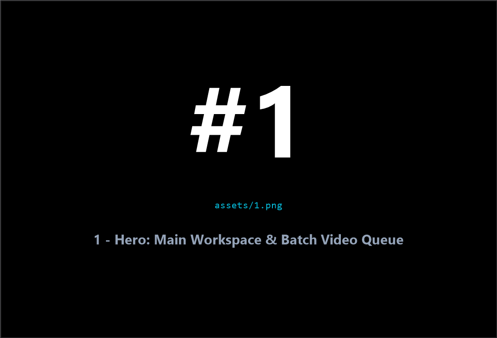
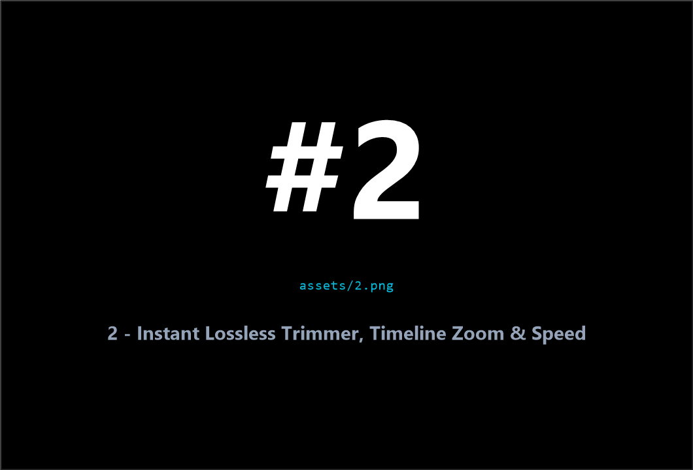
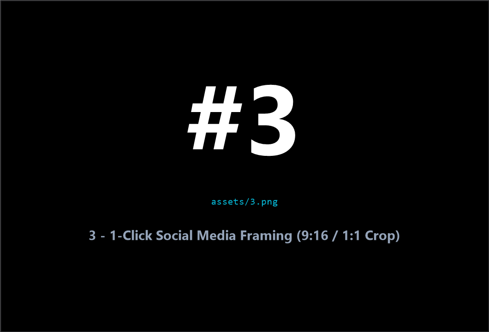
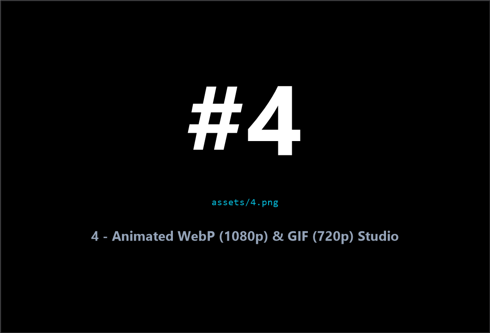
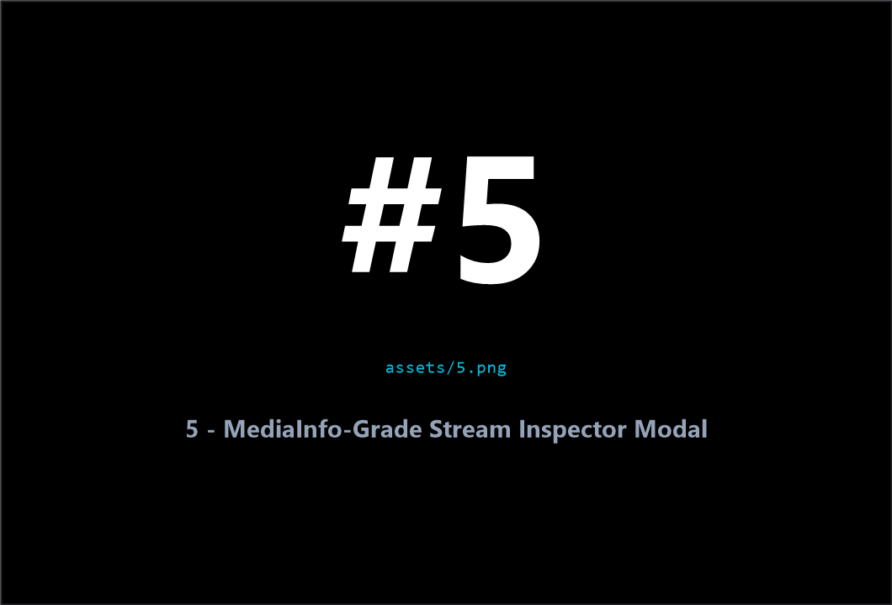
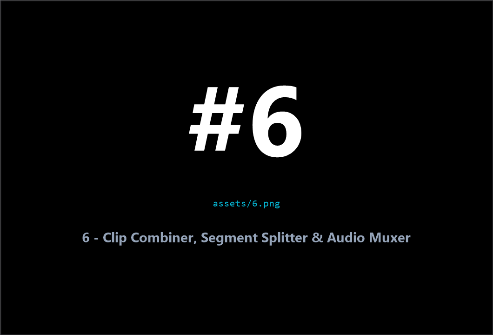
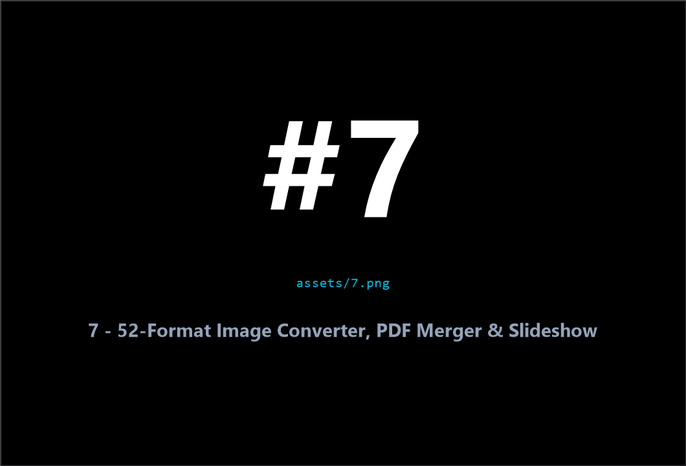
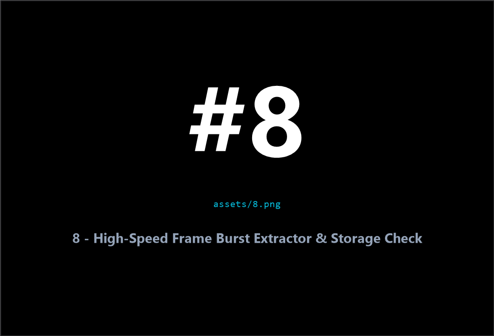
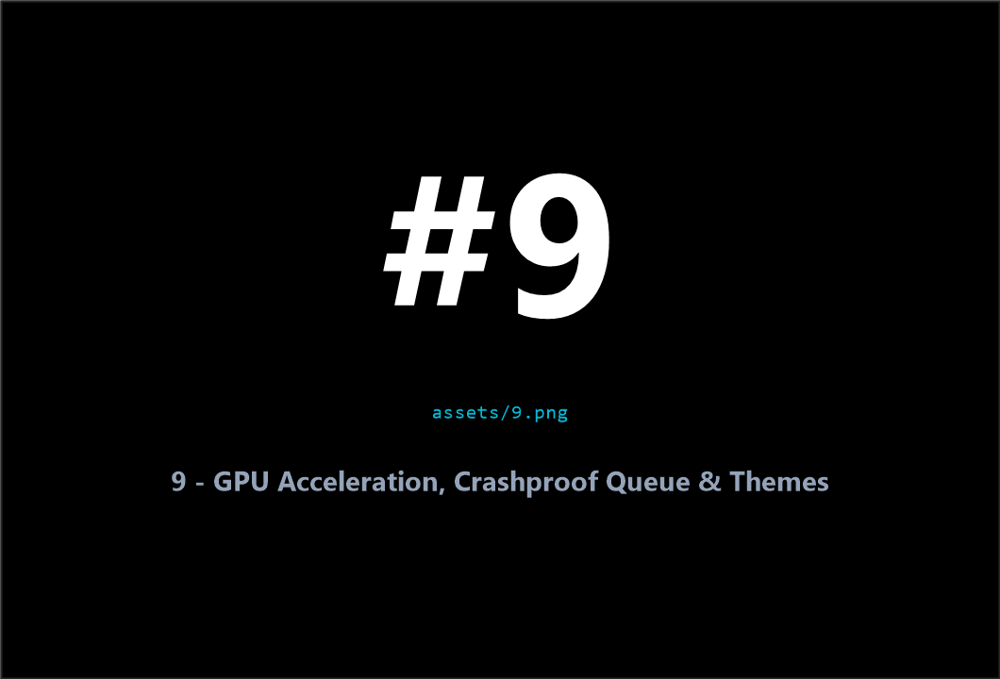

<div align="center">

  # ⚡ ALITKEN

  ### High-Performance Media Converter, Video Trimmer & Animation Studio for Windows 11
  
  *A sleek, borderless, GPU-accelerated desktop utility built with Rust and Tauri v2.*  
  *Lossless cuts in milliseconds • 1-click TikTok/Reels framing • Streaming 1080p WebP & 720p GIF • 52-format image engine.*

  <br />

  <p align="center">
    <a href="https://github.com/Crlyzd/Alitken-GUI/releases/latest"></a>
    <a href="https://github.com/Crlyzd/Alitken-GUI/releases/latest"></a>
    <a href="LICENSE"></a>
    <a href="#-the-manifesto-why-i-built-this-a-rant"></a>
  </p>

  <p align="center">
    <a href="https://github.com/Crlyzd/Alitken-GUI/releases/latest"><b>Download Latest Portable Exe</b></a> •
    <a href="#-feature-matrix-alitken-vs-the-rest"><b>Comparison Matrix</b></a> •
    <a href="#-core-capabilities--showcase"><b>Features & Showcase</b></a> •
    <a href="#-quick-start"><b>Quick Start</b></a> •
    <a href="#-under-the-hood-for-geeks"><b>Tech Specs</b></a> •
    <a href="#-acknowledgments--open-source-attribution"><b>Credits</b></a> •
    <a href="#-support--donations"><b>Support</b></a>
  </p>

  <br />

  

  <br />
  <sub><b>#1 — Main Workspace & Batch Media Queue</b> (<code>assets/1.png</code>)</sub>

</div>

---

### 💬 The Manifesto: Why I Built This (A Rant)

> **TL;DR:** I am so sick and tired of media converters on Windows. Seriously, why is this entire category of software such an absolute unmitigated disaster zone?
>
> * **The Ancient Boomer Tools:** Great underlying code, sure, but the interfaces look like they were compiled on Windows 95 by a backend developer who fundamentally hates human eyes. You are greeted with 4,000 cryptic dropdowns, nested tabs from hell, and a UI that requires a computer science degree in video engineering just to turn a 5-second `.mov` file into an `.mp4`. Why do I need to navigate a 50-page audio codec sub-menu just to trim a video clip for Discord?
> * **The Corporate Paywall Traps:** The shiny-looking converters that rank #1 on search engines spend all their budget on SEO and zero on actual software development. You install it, wait 15 minutes for your file to process, and right when it finishes, it slaps a massive ugly watermark over the center of your video and demands a $49/year recurring subscription just to unlock 1080p export. Absolute predatory garbage.
> * **The "Free" Bloatware Nightmares:** The rest of the "free" utilities out there are horrific. They install 40 background services you can't disable, write garbage to your registry, bundle 500MB of useless bloatware code for a task that should take 20MB, and demand a full administrative setup wizard just to run. And when you finally use them? They take 45 minutes to encode a 30-second video because they don't even use your graphics card, maxing out your CPU at 100% until your fans sound like a jet engine, before inevitably crashing on any modern AV1 or high-framerate clip.
> * **The Online Web Converters:** Don't even get me started on web converters. Uploading a 2GB raw gameplay clip over your home internet, waiting in a server queue for 20 minutes, having your resolution capped at 720p, and navigating through 15 fake "DOWNLOAD HERE" malware popups just to get your file back.
>
> I just wanted **one** normal tool:
> 1. Completely **free** with no paywalls or trial watermarks.
> 2. **Portable** with zero installation bloat or registry clutter.
> 3. **Blazing fast** using real GPU hardware acceleration.
> 4. Able to **losslessly snip clips in seconds** without re-encoding.
> 5. A **modern, sleek Windows 11 UI** that doesn't look like a crime against design.
>
> Nobody else seemed capable of making an app that wasn't either a relic from 2005 or a greedy cash-grab scam, so I built **Alitken**. No bullshit, no paywalls, no bloatware, no hassle.

---

## 📊 Feature Matrix: Alitken vs. The Rest

| Feature | 👴 Traditional "Boomer" Tools | 💸 SEO Paywall Converters | 🌐 Online Web Converters | ⚡ **Alitken** |
| :--- | :---: | :---: | :---: | :---: |
| **Pricing & Watermarks** | Free | $49/yr + Center Watermark | Free with 720p / 100MB cap | **100% Free & Clean** |
| **Installation Footprint** | Clunky MSI installer | 500 MB+ Background Services | Popups & tracking cookies | **~5 MB Portable Single-File Exe** |
| **Video Cutting Speed** | Re-encodes slowly | Re-encodes slowly | Cloud queue upload delay | **Instant Lossless (`< 1 sec`)** |
| **Animated WebP & GIF** | Raw CLI flags only | Watermarked or 10 FPS cap | Heavy compression & size cap | **24-bit 1080p WebP & O(1) 720p GIF** |
| **UI Design & Ergonomics** | Nested 90s tabs & dialogs | Aggressive upgrade ads | Malware-laden banner ads | **Sleek Mica / Acrylic Glass UI** |
| **Mobile Crop (Shorts/TikTok)** | Manual pixel math | Locked behind subscription | Unsupported | **1-Click 9:16 / 1:1 Presets** |
| **Custom Audio & Fade** | Complex multi-pass setup | Paid feature | Unsupported | **Built-in Song Track + Fades** |
| **Hardware Acceleration** | Requires manual setup | Watermarked on free tier | Server-side throttled | **Auto NVIDIA / AMD / Intel** |
| **Queue Error Resilience** | Crashes on bad files | Silent failure | Upload timeout | **Pre-flight 0B / Corrupt Filter** |
| **Deep Stream Inspection** | External tools required | Basic info or paywalled | Unsupported | **Built-in MediaInfo (Specs + Text)** |

---

## 🌟 Core Capabilities & Showcase

Each feature below is paired with a numbered screenshot placeholder in [`assets/`](assets/) so screenshots can be dropped in cleanly (`1.png` – `9.png`).

### #2 — Instant Lossless Trimmer, Seekbar Zoom & Speed Engine (`assets/2.png`)
* **Sub-Second Lossless Cutting**: Snip highlights from multi-hour recordings in milliseconds without touching video packets or losing quality.
* **Precision Timeline Scrubber**: Cursor-anchored seekbar zoom (`1.0x–10.0x`), `Ctrl + Drag` panning, `Shift + Drag` selected-range sliding, single-click playhead summon, and instant D3D11/WMF hover filmstrips.
* **Playback Speed & Slow-Mo (`0.10x–50.00x`)**: Switch between *Fast Frame Dup* and *Optical Smooth (`minterpolate`)* motion interpolation with pitch-preserved chained `atempo` audio and auto-guarded re-encode detection.

<p align="center">
  
</p>

---

### #3 — 1-Click Social Media Framing (`assets/3.png`)
* **Visual Aspect Presets**: Switch instantly between **9:16 (Shorts / TikTok)**, **1:1 (Square)**, **4:5 (Portrait)**, **16:9 (Landscape)**, **4:3**, or **21:9**.
* **GPU Counter-Scaled 1.5px Crop Wireframe**: Edge lines stay razor-sharp at 1.5px across all preview zoom levels with zero subpixel drift.
* **Fluid Handles & Magnetic Edge Snapping**: Drag corners freely without handle locking and snap cleanly to canvas axes.

<p align="center">
  
</p>

---

### #4 — Coexisting Animated WebP (1080p) & O(1) GIF Studio (`assets/4.png`)
* **24-Bit Animated WebP (`libwebp`)**: Stream high-detail (`Q80`) or compact (`Q65`) animations up to **1080p Full HD** with real-time progress and tiny file sizes—no blurry 256-color banding.
* **O(1)-Memory Animated GIF (`stats_mode=single` + `paletteuse=new=1`)**: Single-pass adaptive 256-color GIF export capped safely at **720p HD** with Bayer / Sierra2_4a dithering, configurable FPS (`10` / `15` / `24` / `30` / `Original`), and loop toggle (`ON` / `ONCE`).
* **Unified Across Modes**: Available in batch **Video Convert**, **Video Trimmer**, and **Image-to-Animation** (with 8-bit `yuva420p` smooth alpha transparency in Image mode).

<p align="center">
  
</p>

---

### #5 — MediaInfo-Grade Stream Inspector Modal (`assets/5.png`)
* **Workstation-Grade Telemetry**: Inspect deep video/audio stream properties directly from the queue or trimmer—codec profiles/levels, chroma subsampling, bit depth, color primaries/range, sample rate, channels, and bitrate.
* **Dual-View Frosted Modal**: Toggle between structured visual spec cards and monospaced classic MediaInfo text reports.
* **1-Click Export & Reveal**: Copy paths, open file location in Explorer, copy formatted diagnostic text, or save raw JSON metadata.

<p align="center">
  
</p>

---

### #6 — Clip Combiner, Segment Splitter & Soundtrack Muxer (`assets/6.png`)
* **Multi-Clip Concatenation & Pre-Flight Check**: Automatically verifies stream compatibility for `< 1 sec` lossless concatenation, or normalizes mixed clips seamlessly.
* **Segment Splitter**: Cut long videos by exact duration or equal part count using lossless stream copy or crop-aware re-encode.
* **Audio Replacement & Fade Curves**: Attach custom `.mp3` / `.aac` / `.wav` / `.flac` soundtracks with smooth **Fade In** and **Fade Out** transitions.

<p align="center">
  
</p>

---

### #7 — 52-Format Image Converter, PDF Merger & Photo Slideshow (`assets/7.png`)
* **52+ Input Formats**: Batch convert Camera RAW (`.cr2`, `.cr3`, `.nef`, `.arw`, `.dng`, `.raf`), `.heic`, `.avif`, `.jxl`, `.psd`/`.psb` (composite `[0]` frame), `.svg`, `.ico`, `.webp`, and `.gif` to `.jpg`, `.png`, `.webp`, or single/merged `.pdf`.
* **Photo Slideshow & Image Sequence Engine**: Turn mixed-format, mixed-resolution photo sets into `MP4 Video` (up to `4K`), `Anim WebP` (up to `1080p`, optional `ALPHA` transparency), or `Anim GIF` (up to `720p`, optional `ALPHA`) with majority Portrait/Landscape auto-orientation and zero-disk pipe streaming.

<p align="center">
  
</p>

---

### #8 — High-Speed Frame Burst Extractor & Storage Guard (`assets/8.png`)
* **Batch Frame Sequences**: Extract lossless `.png`, `.jpg`, or `.webp` frame bursts into `_frames/` folders at `Every Frame`, `30`, `10`, `5`, or `1` FPS using VideoLAN `libdav1d` AV1 decoding.
* **Pre-Flight Disk Capacity Check**: Estimates extracted output footprint upfront (`validate_extraction_storage`) and warns before filling up your drive.

<p align="center">
  
</p>

---

### #9 — Automatic GPU Acceleration, Crashproof Queue & Glass UI (`assets/9.png`)
* **Zero-Config GPU Probing**: Auto-detects **NVIDIA NVENC**, **AMD AMF**, or **Intel QSV** (H.264 / H.265 / AV1) alongside pure audio stream passthrough (`-c:a copy`).
* **Crashproof Queue Guardrails**: Detects missing or 0-byte corrupted media before processing starts with 1-click invalid file cleanup.
* **Borderless Acrylic UI & Themes**: Adaptive Dark / Light frosted glass workspace with dynamic Startup (`500×500`) to Working (`1060×720`) window transitions and working-set memory compaction.

<p align="center">
  
</p>

---

### 📸 Screenshot Placeholder Quick Map (`assets/`)

Replace the black numbered PNGs in [`assets/`](assets/) with real captures:

| File | Section | Subject to Capture |
| :--- | :--- | :--- |
| `assets/1.png` | Hero Banner | Main workspace with queued videos/images & config sidebar |
| `assets/2.png` | Lossless Trimmer | Trimmer timeline zoomed in with In/Out handles & speed controls |
| `assets/3.png` | Social Framing | Trimmer 9:16 or 1:1 crop wireframe overlay |
| `assets/4.png` | WebP & GIF Studio | `WEBP / GIF` codec card selected showing `GifExportControls` |
| `assets/5.png` | MediaInfo Inspector | `MediaDetailsModal` open showing Visual Specs / MediaInfo text |
| `assets/6.png` | Combiner & Splitter | Combine or Split mode controls with compatibility badge & audio fades |
| `assets/7.png` | Image & Slideshow Mode | Image config panel showing `Video & Animation` pills & options |
| `assets/8.png` | Frame Burst Extractor | `Extract Frames` panel & optional large-frame storage warning |
| `assets/9.png` | GPU, Queue & Themes | Progress / Settings modal or Light/Dark mode titlebar GPU badge |

---

## 🚀 Quick Start

1. **Download**: Grab `Alitken_64-Portable.exe` from the [Latest Releases](https://github.com/Crlyzd/Alitken-GUI/releases/latest).
2. **Drop Your Media**: Drag video or image files directly into the `500×500` startup window (or right-click any file in Windows Explorer and select **Send to → Alitken**).
3. **Choose Mode**:
   * **Video Convert / Animation**: Encode to `.mp4` / `.mkv` (H.264, H.265, AV1) or export to `.webp` (up to 1080p) / `.gif` (up to 720p).
   * **Split / Trim**: Mark start/end cuts, tweak speed (`0.10x–50.00x`), or crop to `9:16` / `1:1`.
   * **Combine**: Merge ordered clips and attach a custom soundtrack with Fade In/Out.
   * **Extract Frames**: Sample burst sequences into `.png`, `.jpg`, or `.webp`.
   * **Image & Slideshow**: Batch convert 52+ image formats, merge PDFs, or animate sequences to `.mp4`, `.webp`, or `.gif`.
4. **Start**: Click the primary action button and monitor real-time progress telemetry.

---

## 🤓 Under the Hood (For Geeks)

```
+-------------------------------------------------------------------------+
|                       ALITKEN ARCHITECTURE                              |
+-------------------------------------------------------------------------+
|  Frontend UI          React 18 • TypeScript 5.7 • Vanilla CSS Glass     |
|  Desktop Runtime      Tauri v2 • Win32 Subclassing (Borderless Mica)    |
|  Native Core          Rust (2021 Edition) • Tokio Asynchronous Runtime  |
|  Subprocess Engines   FFmpeg (GPLv3) • FFprobe • ImageMagick 7          |
|  Hardware Decoders    VideoLAN libdav1d AV1 Engine (700+ FPS Decoding)  |
|  Hardware Encoders    NVIDIA NVENC • AMD AMF • Intel QuickSync (QSV)    |
|  Animation Engine     Streaming libwebp (yuva420p) • O(1) GIF Palette   |
|  Memory Optimization  Windows Working-Set Compaction • Temp Cache Pool  |
+-------------------------------------------------------------------------+
```

* **True Borderless Frame Compositing**: Native Win32 window subclassing locks Startup resizing & `SC_MAXIMIZE` Windows Snap (`500×500`) and eliminates the DWM 1px border stroke before expanding to Working mode (`1060×720`).
* **Modular Domain Architecture**: Frontend components (`< 250–300 LOC`) and backend Rust modules (`< 300–400 LOC`) enforce strict single-responsibility decomposition.
* **O(1)-Memory Image & Animation Pipes**: Heterogeneous and alpha-transparent image batches stream directly through `magick.exe` `ppm:-` / `pam:-` pipes into FFmpeg `image2pipe` with zero temp disk frame bloat (`pipe.rs`), falling back to 3-stage concat normalization (`demuxer.rs`) when needed.
* **Zero-Zombie Subprocess Guardrails**: Every FFmpeg and ImageMagick child process binds to atomic cancellation flags with automatic cleanup of partial outputs and temp manifests on abort or exit.

---

## 💻 System Requirements & Media Compatibility

* **Operating System**: Windows 10 or Windows 11 (Native 64-bit x86_64 & ARM64)
* **Supported Video Inputs**: `.mp4`, `.mkv`, `.webm`, `.mov`, `.avi`, `.wmv`, `.m4v`, `.flv`, `.ts`, `.mts`, `.m2ts`, `.3gp`, `.mxf`
* **Video Output Targets**: `.mp4` (H.264 / HEVC), `.mkv` (AV1), `.webp` (Animated WebP up to 1080p), `.gif` (Animated GIF up to 720p), or original container (Lossless Cut)
* **Soundtrack & Audio Tracks**: `.mp3`, `.aac`, `.wav`, `.m4a`, `.flac` *(used for background music replacement & video audio muxing)*
* **Supported Image Inputs (52+ Formats)**:
  * **Standard & Modern**: `.png`, `.jpg`, `.jpeg`, `.webp`, `.bmp`, `.gif`, `.tiff`, `.heic`, `.heif`, `.avif`, `.jxl`, `.qoi`
  * **Creative & Vector**: Photoshop (`.psd`, `.psb` `[0]` composite frame), Vector (`.svg`, `.svgz`), GIMP (`.xcf`), Icons (`.ico`, `.cur`)
  * **Gaming & VFX**: `.dds`, `.tga`, Pixel art (`.ase`, `.aseprite`), OpenEXR (`.exr`), Radiance HDR (`.hdr`)
  * **Archival & Camera RAW**: `.dng`, `.cr2`, `.cr3`, `.nef`, `.arw`, `.orf`, `.rw2`, `.pef`, `.raf`, `.fff`, `.dcr`, `.kdc`, `.k25`, `.erf`, `.srw`, `.mrw`, `.mef`, `.mos`, `.3fr`, `.raw`, `.x3f`
* **Image Output Targets**: `.png`, `.jpg`, `.webp`, `.pdf` (1-to-1 or merged), `.mp4` (Slideshow/Sequence up to 4K), `.webp` (Animated WebP up to 1080p, alpha supported), or `.gif` (Animated GIF up to 720p, alpha supported)

---

## 🛠️ Developer Toolchain (`build.ps1`)

Alitken provides a consolidated PowerShell dashboard for local development, MSIX/NSIS/Portable releases, `.msixbundle` generation, asset generation, and versioning:

```powershell
.\build.ps1                              # Launch interactive developer dashboard
.\build.ps1 -Dev                         # Start Vite + Tauri development server
.\build.ps1 -ReleaseScope all            # Build multi-target x64/ARM64 release packages
.\build.ps1 -Bump -BumpType patch        # Bump & sync version across all manifests
```

---

## 🙏 Acknowledgments & Open-Source Attribution

Alitken stands on the shoulders of extraordinary open-source engines, system bindings, and UI toolkits. Huge thanks to the maintainers and contributors of every project below:

### Media, Image & Codec Engines

| Library / Tool | License | Role in Alitken |
| :--- | :--- | :--- |
| **[FFmpeg](https://ffmpeg.org/) & `ffprobe`** | GPLv3 | Core video transcoding, lossless stream cutting, audio muxing, O(1) GIF palette streaming, and `image2pipe` sequence encoding |
| **[BtbN/FFmpeg-Builds](https://github.com/BtbN/FFmpeg-Builds)** | GPLv3 | Automated Windows x64 & ARM64 GPLv3 FFmpeg builds fetched by Alitken's dependency manager |
| **[ImageMagick 7](https://github.com/ImageMagick/ImageMagick)** | ImageMagick License | 52+ format image conversion, Camera RAW / PSD / HEIC decoding, PDF generation, and `ppm:-` / `pam:-` raw pipe streaming |
| **[VideoLAN `libdav1d`](https://code.videolan.org/videolan/dav1d)** | BSD-2-Clause | High-speed AV1 software decoding (up to Level 7.3) |
| **[`libwebp`](https://chromium.googlesource.com/webm/libwebp)** *(Google WebP Project)* | BSD-3-Clause | 24-bit Animated WebP and 8-bit `yuva420p` alpha-transparent WebP encoding |
| **[`x264`](https://www.videolan.org/developers/x264.html), [`x265`](https://www.videolan.org/developers/x265.html) & [`libaom-av1`](https://aomedia.googlesource.com/aom/)** | GPLv2 / Apache-2.0 | Software fallback video encoders alongside hardware-accelerated NVIDIA NVENC, AMD AMF, and Intel QuickSync (QSV) |

### Native Backend & Windows Runtime (Rust)

| Library / Crate | License | Role in Alitken |
| :--- | :--- | :--- |
| **[Tauri v2](https://v2.tauri.app/)** (`tauri`, `tauri-plugin-dialog`, `tauri-plugin-opener`) | Apache-2.0 / MIT | Lightweight native desktop shell, IPC bridge, and native file/URL dialogs |
| **[Rust](https://www.rust-lang.org/) & [Tokio](https://tokio.rs/)** | MIT / Apache-2.0 | Asynchronous runtime, non-blocking child process management, and real-time progress telemetry |
| **[`windows-rs`](https://github.com/microsoft/windows-rs) & `windows-sys`** | MIT / Apache-2.0 | Win32 DWM borderless frame subclassing, Windows Media Foundation (WMF) & Direct3D 11 (`D3D11`) hardware frame extraction, and working-set memory compaction |
| **[`serde`](https://serde.rs/) & `serde_json`** | MIT / Apache-2.0 | Strongly typed IPC payload serialization and media inspection parsing |
| **[`reqwest`](https://github.com/seanmonstar/reqwest), [`zip`](https://github.com/zip-rs/zip2) & [`sevenz-rust`](https://github.com/dyz1990/sevenz-rust)** | MIT / Apache-2.0 | Dependency downloads, `.zip` extraction, and `.7z` archive unpacking |
| **[`regex`](https://github.com/rust-lang/regex), [`walkdir`](https://github.com/BurntSushi/walkdir), [`dirs`](https://github.com/dirs-dev/dirs-rs), [`log`](https://github.com/rust-lang/log) & [`env_logger`](https://github.com/rust-cli/env_logger)** | MIT / Apache-2.0 | Progress telemetry parsing, directory traversal, system path resolution, and application logging |

### Frontend UI & Build Tooling

| Library / Tool | License | Role in Alitken |
| :--- | :--- | :--- |
| **[React 18](https://react.dev/) & [TypeScript 5.7](https://www.typescriptlang.org/)** | MIT / Apache-2.0 | Reactive UI architecture and strict static typing |
| **[Vite 6](https://vite.dev/)** | MIT | Frontend build toolchain and HMR dev server |
| **[Lucide (`lucide-react`)](https://lucide.dev/) & [`clsx`](https://github.com/lukeed/clsx)** | ISC / MIT | Vector iconography and conditional styling utilities |

---

## ❤️ Support & Donations

Alitken is completely free, open source, and built with love by **Kaleksanan Bagus**. If this tool saved you from subscription scams, watermarked videos, or jet-engine CPU fans, consider buying me a coffee:

<p align="center">
  <a href="https://saweria.co/curlyzed"></a>
  &nbsp;&nbsp;
  <a href="https://ko-fi.com/curlyzed"></a>
</p>

---

<div align="center">
  <sub>Licensed under <a href="LICENSE">GNU General Public License v3.0</a>. Built for creators, gamers, and humans.</sub>
</div>
